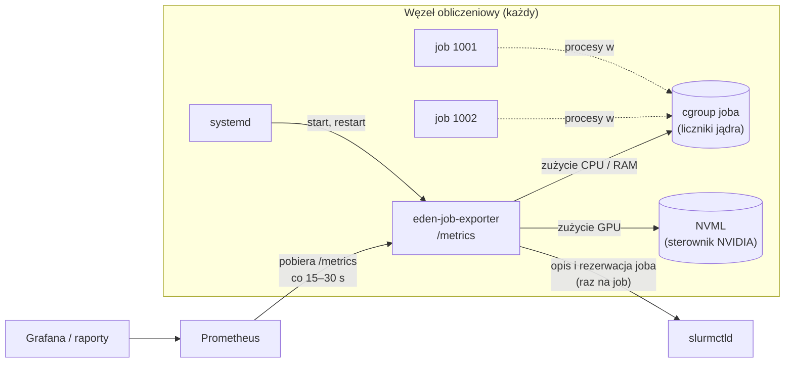
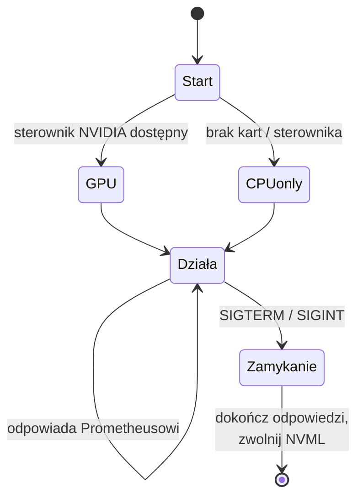
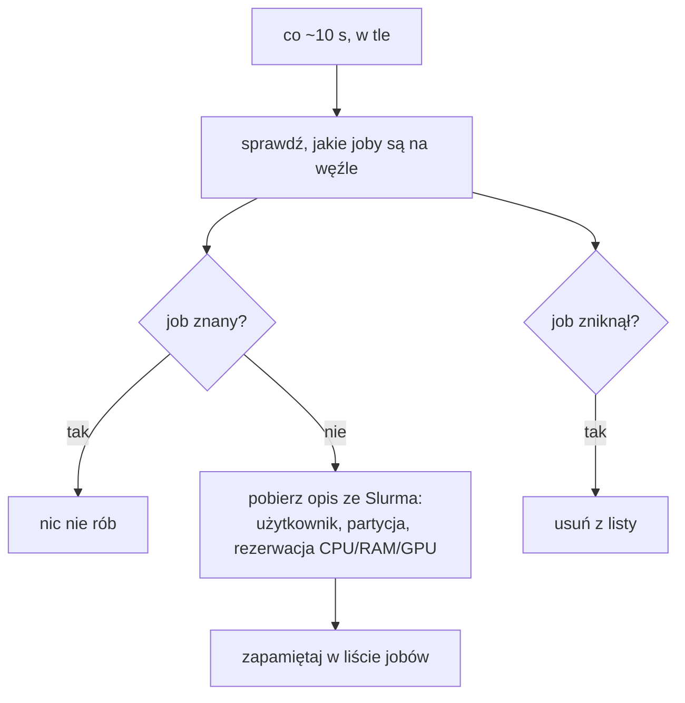
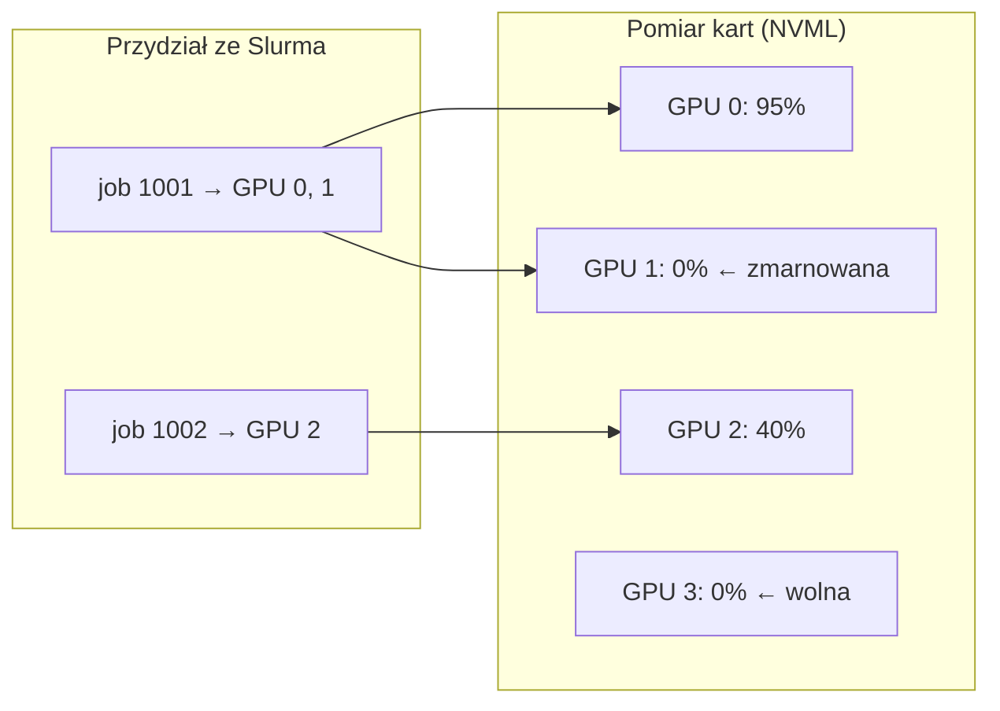
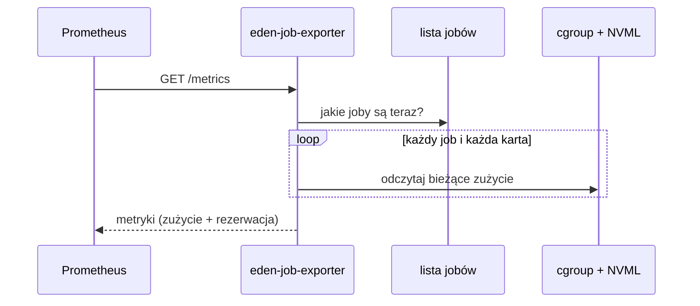

# Eden Job Exporter: specyfikacja architektoniczna (wersja robocza)

## 1. Cel

Demon działający stale na każdym węźle obliczeniowym. Bez żadnych ręcznych kroków udostępnia dla **każdego joba Slurma**:

- ile zasobów (CPU, RAM, GPU) job **zużywa**,
- ile zasobów job **zarezerwował**.

Na tej podstawie Prometheus i Grafana pokazują, które joby marnują zasoby.

---

## 2. Architektura



- **Model pull:** demon niczego nie wysyła sam. Prometheus przychodzi po dane.
- **Zużycie** pochodzi z węzła (cgroup, NVML), **opis i rezerwacja** joba ze Slurma.

---

## 3. Cykl życia



- Uruchamiany przez **systemd**: start z systemem (po Slurmie), restart po awarii, bez uprawnień roota.
- **Jedna instancja na węźle:** zapewnia ją systemd.
- Węzeł **bez GPU**: demon działa dalej i zbiera tylko CPU i RAM.

---

## 4. Odkrywanie jobów



- Odkrywanie działa w tle, niezależnie od Prometheusa, bo zapytanie do Slurma bywa wolne.
- Slurm jest pytany **raz na job**, a nie przy każdym pomiarze.

---

## 5. Przypisanie GPU do joba



Kartę przypisujemy do joba **według przydziału Slurma**, a nie według procesów działających na karcie.
Karta zarezerwowana, ale nieużywana, nie ma procesów, więc tylko przydział pozwala odróżnić kartę *zmarnowaną* od *wolnej*.

---

## 6. Pobieranie danych przez Prometheusa



- Dane odczytywane są **w chwili zapytania**, demon nie ma własnej pętli pomiarowej.
- Czas CPU eksportowany jest jako rosnący licznik, obciążenie liczy Prometheus.

---

## 7. Metryki

To „umowa” z Grafaną i raporty: nazwy zmieniamy tylko świadomie.

| Metryka | Co mierzy |
|---|---|
| `eden_job_info` | opis joba: użytkownik, konto, partycja, nazwa |
| `eden_job_cpu_usage_seconds_total` | zużyty czas CPU (licznik) |
| `eden_job_cpus_allocated` | zarezerwowane rdzenie |
| `eden_job_memory_used_bytes` | bieżące zużycie RAM |
| `eden_job_memory_peak_bytes` | szczytowe zużycie RAM |
| `eden_job_memory_allocated_bytes` | zarezerwowany RAM |
| `eden_job_gpus_allocated` | zarezerwowane karty |
| `eden_job_time_limit_seconds` | limit czasu joba |
| `eden_job_start_time_seconds` | czas startu joba |
| `eden_gpu_utilization_ratio` | wykorzystanie karty (0–1), z przypisaniem do joba |
| `eden_gpu_memory_used_bytes` | zajęta pamięć karty |

Przykład: GPU zarezerwowane, ale bezczynne od 30 minut:

```promql
avg_over_time(eden_gpu_utilization_ratio{job_id!=""}[30m]) < 0.05
```

---
