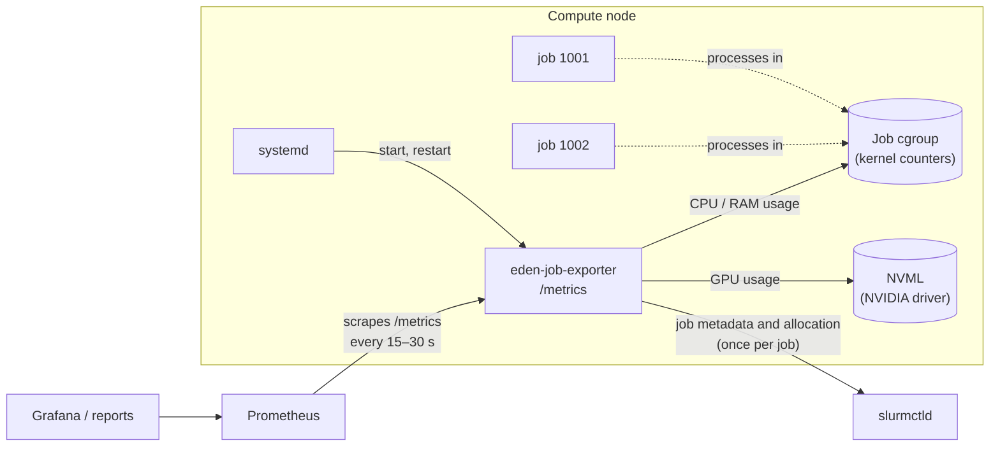
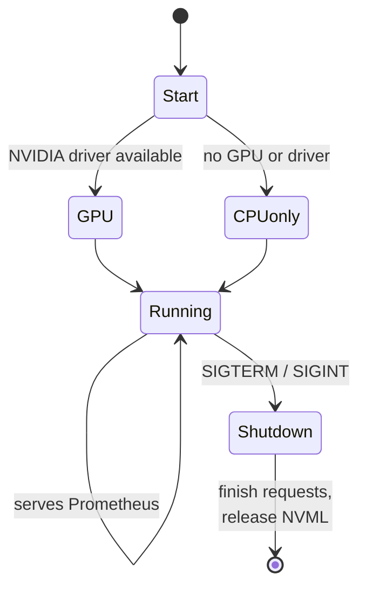
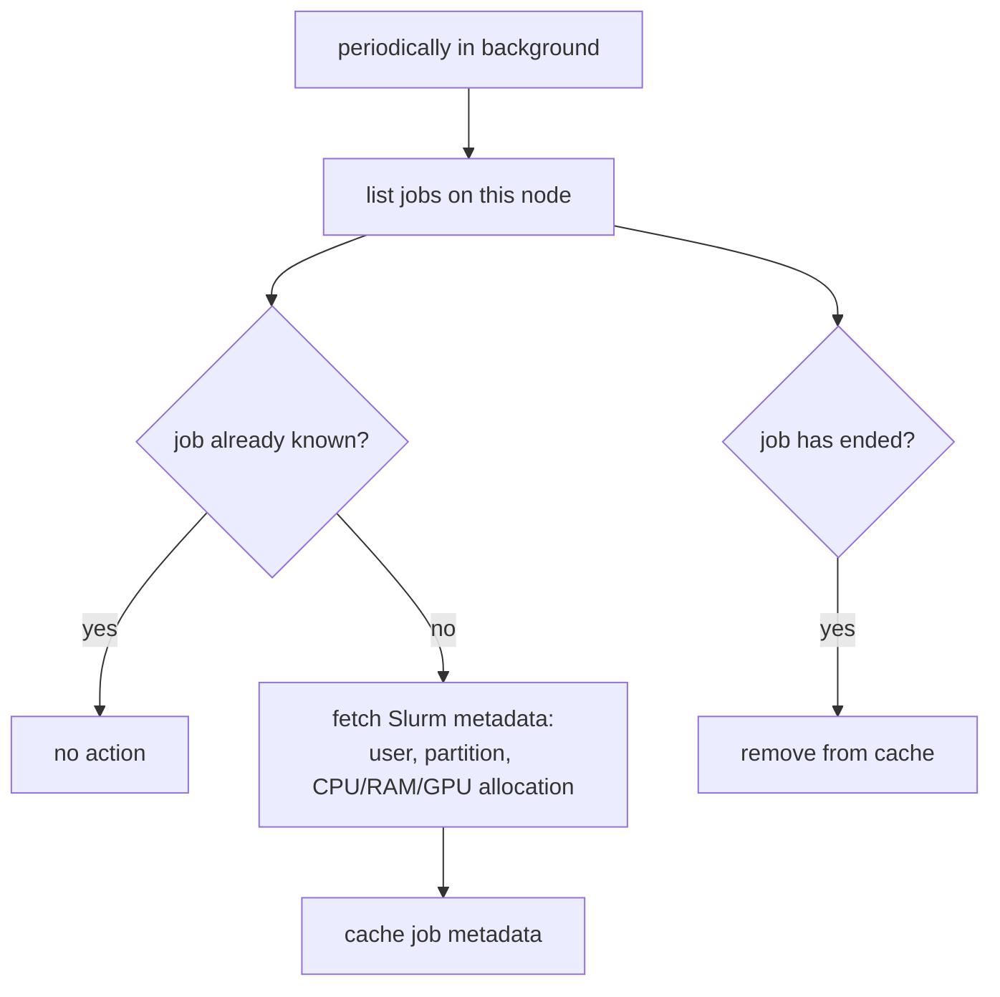
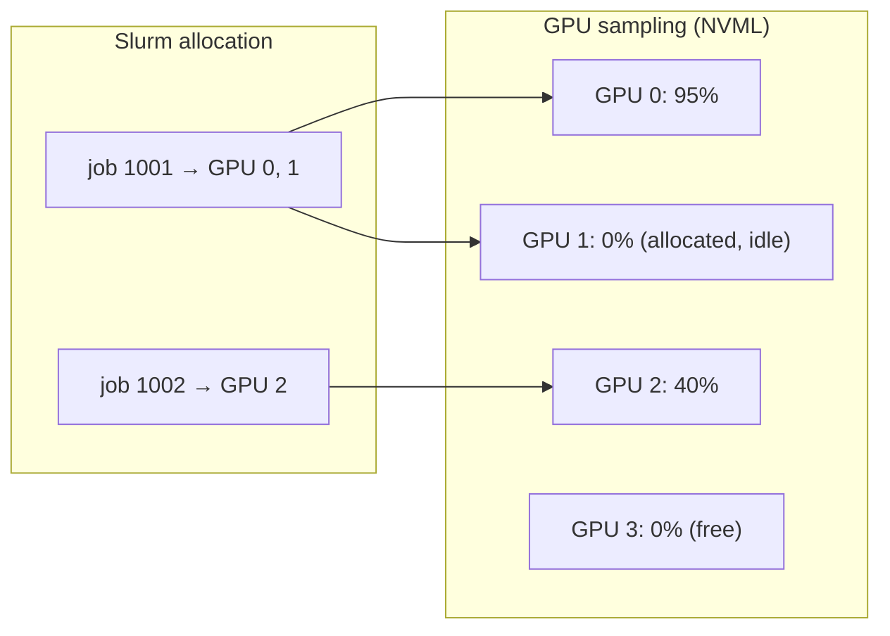
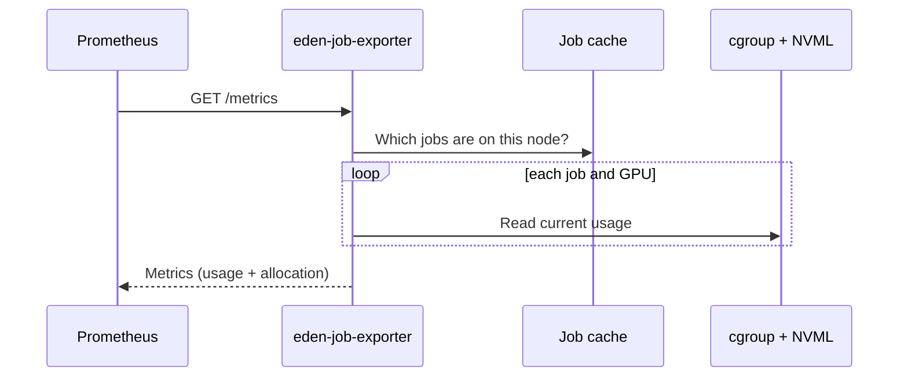

# Eden Job Exporter: Architecture Specification (Draft)

## 1. Goal

Run a daemon continuously on each compute node. Without manual steps, expose
for **every Slurm job**:

- the CPU, RAM, and GPU resources the job **uses**;
- the resources the job **has allocated**.

Prometheus and Grafana can then show where allocated resources are underused.

## 2. Architecture



- **Pull model:** the daemon does not push data; Prometheus scrapes it.
- **Usage** comes from the node (cgroups and NVML); **job metadata and
  allocations** come from Slurm.

## 3. Lifecycle



- Run under **systemd**: start with the node after Slurm, restart after a crash,
  and run without root privileges.
- **One instance per node:** systemd provides this guarantee.
- On a node **without GPUs**, continue collecting CPU and RAM metrics.

## 4. Job discovery



- Discovery runs in the background, independently of Prometheus, because
  querying Slurm can be slow.
- Query Slurm **once per job**, not for every metric scrape.

## 5. Associate GPUs with jobs



Associate a GPU with a job **using Slurm's allocation**, not by inspecting
processes on the GPU. An allocated but idle GPU has no processes, so allocation
data is needed to distinguish an *underused* GPU from a *free* one.

## 6. Prometheus scrape



- Read values **when scraped**; the daemon does not need its own sampling loop.
- Export CPU time as a monotonically increasing counter; Prometheus computes
  rates and utilization.

## 7. Metrics

This metric set is a contract for dashboards and reports. Rename metrics only
deliberately.

| Metric | Meaning |
|---|---|
| `eden_job_info` | Job metadata: user, account, partition, and name |
| `eden_job_cpu_usage_seconds_total` | Cumulative CPU time |
| `eden_job_cpus_allocated` | Allocated CPU cores |
| `eden_job_memory_used_bytes` | Current RAM use |
| `eden_job_memory_peak_bytes` | Peak RAM use |
| `eden_job_memory_allocated_bytes` | Allocated RAM |
| `eden_job_gpus_allocated` | Allocated GPUs |
| `eden_job_time_limit_seconds` | Job time limit |
| `eden_job_start_time_seconds` | Job start time |
| `eden_gpu_utilization_ratio` | GPU utilization (0–1), associated with a job |
| `eden_gpu_memory_used_bytes` | GPU memory in use |

Example: a GPU allocated to a job but idle for 30 minutes:

```promql
avg_over_time(eden_gpu_utilization_ratio{job_id!=""}[30m]) < 0.05
```

This is a draft target design. See [the current implementation notes](DOCUMENTATION.md)
for the metrics and behavior that exist in the active application today.
