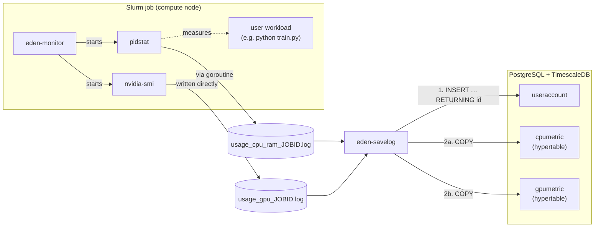
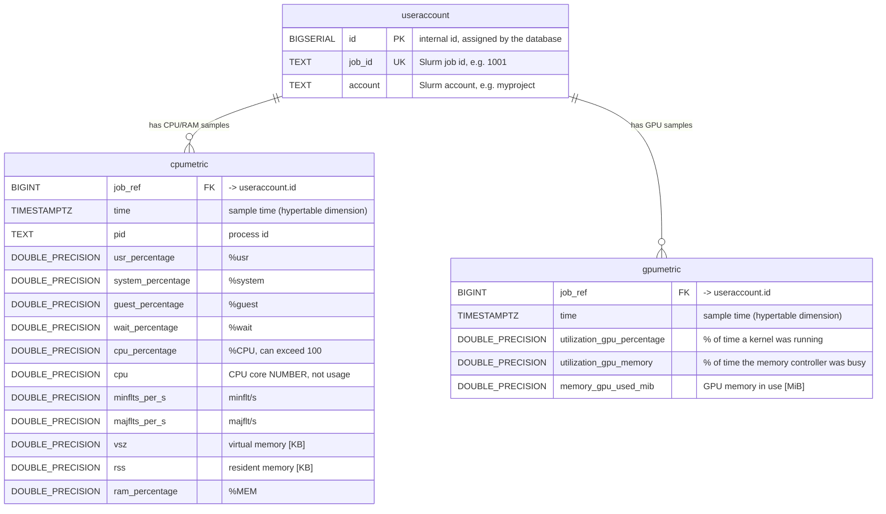
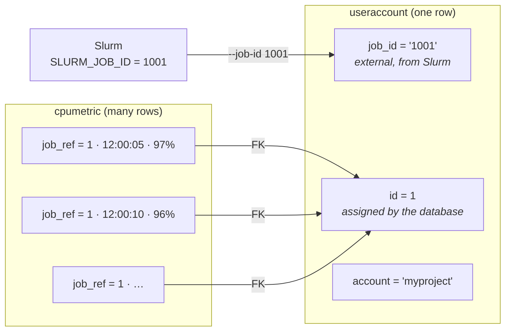
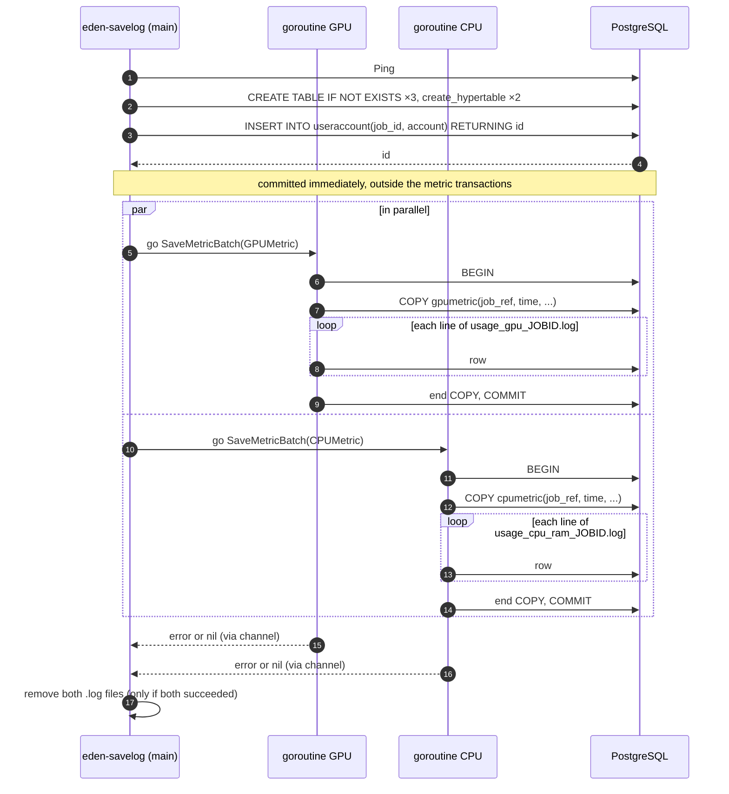
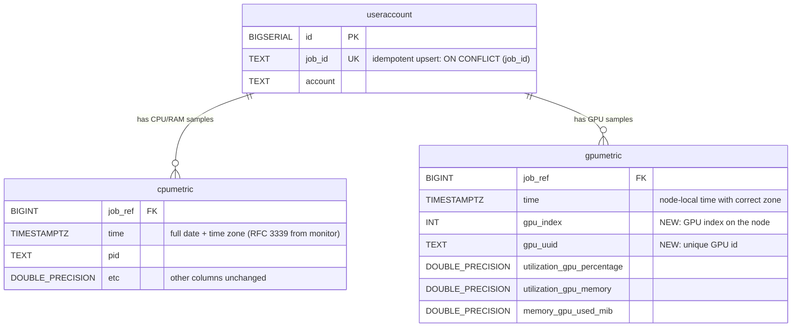

# Database schema

This document describes the PostgreSQL + TimescaleDB database used by `eden-savelog`
(`app/send_logs_to_db`) to store per-job CPU, RAM and GPU metrics collected by `eden-monitor`
(`app/monitor`).

The schema is created automatically by `InitDatabase()` in
[`app/send_logs_to_db/database_connection.go`](../app/send_logs_to_db/database_connection.go).

> Diagrams use [Mermaid](https://mermaid.js.org/) and render on GitHub. In VS Code install the
> *Markdown Preview Mermaid Support* extension to see them in the preview.

---

## 1. Where the database fits



---

## 2. Tables



Legend: `PK` primary key, `UK` unique, `FK` foreign key, `||--o{` one-to-many
(one job has zero or more samples).

### `useraccount`

One row per Slurm job. Despite its name, the table stores **jobs**, not user accounts.

| Column | Type | Constraints | Description |
|---|---|---|---|
| `id` | `BIGSERIAL` | `PRIMARY KEY` | Internal id assigned by the database (1, 2, 3, …). Used to join tables. |
| `job_id` | `TEXT` | `UNIQUE` | Slurm job id (`$SLURM_JOB_ID`), passed via `--job-id`. |
| `account` | `TEXT` | | Slurm account (`$SLURM_JOB_ACCOUNT`), passed via `--account`. |

### `cpumetric` (hypertable on `time`)

One row per `pidstat` sample line. Source: `pidstat -h -r -u -C <name> 5`.

| Column | Type | `pidstat` column | Description |
|---|---|---|---|
| `job_ref` | `BIGINT` | — | `NOT NULL`, references `useraccount(id)` `ON DELETE CASCADE` |
| `time` | `TIMESTAMPTZ` | `Time` | Sample time (`NOT NULL`) |
| `pid` | `TEXT` | `PID` | Process id |
| `usr_percentage` | `DOUBLE PRECISION` | `%usr` | CPU time in user space |
| `system_percentage` | `DOUBLE PRECISION` | `%system` | CPU time in kernel space |
| `guest_percentage` | `DOUBLE PRECISION` | `%guest` | CPU time running a virtual CPU |
| `wait_percentage` | `DOUBLE PRECISION` | `%wait` | Time waiting to run |
| `cpu_percentage` | `DOUBLE PRECISION` | `%CPU` | Total CPU usage; >100 for multi-threaded processes |
| `cpu` | `DOUBLE PRECISION` | `CPU` | **Number of the core** the process ran on — not a usage value |
| `minflts_per_s` | `DOUBLE PRECISION` | `minflt/s` | Minor page faults per second |
| `majflts_per_s` | `DOUBLE PRECISION` | `majflt/s` | Major page faults per second (needed disk I/O) |
| `vsz` | `DOUBLE PRECISION` | `VSZ` | Virtual memory size [KB] |
| `rss` | `DOUBLE PRECISION` | `RSS` | Resident set size — RAM actually used [KB] |
| `ram_percentage` | `DOUBLE PRECISION` | `%MEM` | RSS as % of node memory |

### `gpumetric` (hypertable on `time`)

One row per `nvidia-smi` sample line. Source:
`nvidia-smi --query-gpu=timestamp,utilization.gpu,utilization.memory,memory.used --format=csv -l 5`.

| Column | Type | `nvidia-smi` field | Description |
|---|---|---|---|
| `job_ref` | `BIGINT` | — | `NOT NULL`, references `useraccount(id)` `ON DELETE CASCADE` |
| `time` | `TIMESTAMPTZ` | `timestamp` | Sample time (`NOT NULL`) |
| `utilization_gpu_percentage` | `DOUBLE PRECISION` | `utilization.gpu` | % of the sample period during which a kernel was executing |
| `utilization_gpu_memory` | `DOUBLE PRECISION` | `utilization.memory` | % of time the memory controller was busy — **not** memory occupancy |
| `memory_gpu_used_mib` | `DOUBLE PRECISION` | `memory.used` | GPU memory in use [MiB] |

### Rules enforced by the schema

| Rule | Comes from | Effect |
|---|---|---|
| One row per Slurm job | `job_id UNIQUE` | Saving the same job twice fails with a duplicate key error |
| Every sample belongs to a job | `job_ref NOT NULL REFERENCES useraccount(id)` | A sample cannot be stored without an existing job row |
| Deleting a job deletes its samples | `ON DELETE CASCADE` | `DELETE FROM useraccount WHERE job_id = '1001'` also cleans both metric tables |
| No primary key or unique constraint on metric tables | — | Common for time-series tables (on a hypertable any PK/unique index must include `time`). A CPU sample is identified by (`job_ref`, `time`, `pid`); GPU samples from different GPUs at the same time currently cannot be told apart (see limitations). Duplicate rows are not prevented. |
| Time-partitioned storage | `create_hypertable(<table>, 'time')` | TimescaleDB splits the tables into time chunks (7 days by default) and creates an index on `time` |

---

## 3. Two identifiers: `job_id` vs `id`




| Name | Where | Meaning |
|---|---|---|
| `job_id` | `useraccount` | External id coming from Slurm. Use it to **look up** a job. |
| `id` | `useraccount` | Internal id generated by the database. Use it to **join** tables. |
| `job_ref` | `cpumetric`, `gpumetric` | Foreign key: "this sample belongs to `useraccount.id` = X". |

---

## 4. How `eden-savelog` writes data



Notes:

- `CREATE TABLE IF NOT EXISTS` does **not** modify existing tables. After changing the schema in code,
  drop the tables in your development database:
  `DROP TABLE cpumetric, gpumetric, useraccount CASCADE;`
- `COPY` (via `pq.CopyIn`) is used instead of individual `INSERT`s because it is much faster for
  many rows. The column order in `pq.CopyIn(...)` must match the argument order in `stmt.Exec(...)`
  in [`read_files.go`](../app/send_logs_to_db/read_files.go).

---

## 5. Example data

`useraccount`

| id | job_id | account |
|---:|---|---|
| 1 | 1001 | myproject |
| 2 | 1002 | nlp-group |

`cpumetric` (subset of columns)

| job_ref | time | pid | cpu_percentage | cpu | rss | ram_percentage |
|---:|---|---|---:|---:|---:|---:|
| 1 | 2026-10-13 12:00:05+00 | 12345 | 97.0 | 3 | 512000 | 1.20 |
| 1 | 2026-10-13 12:00:10+00 | 12345 | 96.0 | 5 | 514000 | 1.21 |
| 2 | 2026-10-14 10:00:00+00 | 777 | 380.0 | 12 | 9800000 | 7.50 |

`gpumetric`

| job_ref | time | utilization_gpu_percentage | utilization_gpu_memory | memory_gpu_used_mib |
|---:|---|---:|---:|---:|
| 1 | 2026-10-13 12:00:05+00 | 87 | 40 | 30512 |
| 1 | 2026-10-13 12:00:10+00 | 85 | 38 | 30512 |

---

## 6. Example queries

```sql
-- All CPU samples of Slurm job 1001
SELECT c.*
FROM cpumetric c
JOIN useraccount u ON u.id = c.job_ref
WHERE u.job_id = '1001'
ORDER BY c.time;

-- GPU summary per job
SELECT u.job_id, u.account,
       avg(g.utilization_gpu_percentage) AS avg_gpu_util,
       max(g.memory_gpu_used_mib)        AS peak_gpu_mem_mib
FROM gpumetric g
JOIN useraccount u ON u.id = g.job_ref
GROUP BY u.job_id, u.account;

-- Average GPU utilisation in 1-minute buckets (TimescaleDB)
SELECT time_bucket('1 minute', g.time) AS minute,
       avg(g.utilization_gpu_percentage)
FROM gpumetric g
JOIN useraccount u ON u.id = g.job_ref
WHERE u.job_id = '1001'
GROUP BY minute
ORDER BY minute;

-- Check that the hypertables exist
SELECT hypertable_name FROM timescaledb_information.hypertables;
```

---

## 7. Known limitations

| Limitation | Where | Consequence |
|---|---|---|
| CPU `time` is parsed from `pidstat` as time-of-day only (`15:04:05`) | `read_files.go` | Stored timestamps have no real date; AM/PM is ignored |
| GPU `time` is node-local time parsed as UTC | `read_files.go` | Timestamps can be shifted by the node's UTC offset |
| No GPU index/UUID column | `gpumetric` | On multi-GPU nodes rows from different GPUs cannot be told apart |
| No uniqueness on metric rows | `cpumetric`, `gpumetric` | Uploading the same samples twice would store duplicates |
| `useraccount` row is inserted outside the metric transactions | `SaveMetricToDB` | If metric upload fails, re-running for the same job fails on `UNIQUE(job_id)` |
| CPU and GPU are committed in separate transactions | `SaveMetricToDB` | A job can end up with CPU data but no GPU data (or vice versa) |
| Connection string is hard-coded | `main.go` | Changing the database requires recompiling |

---

## 8. Planned changes

Not implemented yet — proposals under discussion.



| # | Change | Reason |
|---|---|---|
| 1 | Add `gpu_index`, `gpu_uuid` to `gpumetric` | Distinguish GPUs on multi-GPU nodes |
| 2 | Store full timestamps with time zone for CPU and GPU samples | Correct dates and time zones |
| 3 | Make saving idempotent (`INSERT … ON CONFLICT (job_id)`, delete old samples before `COPY`) | Allow safe re-runs after a failure |
| 4 | Add indexes `(job_ref, time DESC)` on both metric tables | Fast "all samples of job X" queries |
| 5 | Rename `useraccount` → `job` | The table stores jobs, not accounts |
| 6 | Rename `cpu` → `cpu_core` (`INT`) | The column is a core number, not a usage value |

---

## 9. Local development database

```bash
docker run -d --name eden-tsdb -p 5432:5432 \
  -e POSTGRES_PASSWORD=mysecretpassword \
  timescale/timescaledb:latest-pg17

# inspect
docker exec -it eden-tsdb psql -U postgres -c '\dt'
docker exec -it eden-tsdb psql -U postgres -c '\d cpumetric'

# reset after a schema change
docker exec -it eden-tsdb psql -U postgres -c 'DROP TABLE cpumetric, gpumetric, useraccount CASCADE;'
```

The credentials above match the connection string currently hard-coded in
[`app/send_logs_to_db/main.go`](../app/send_logs_to_db/main.go).
